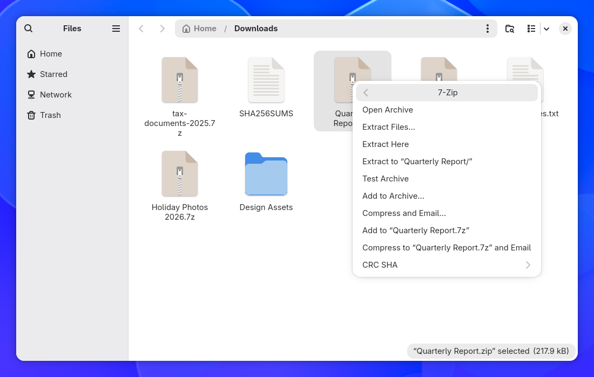
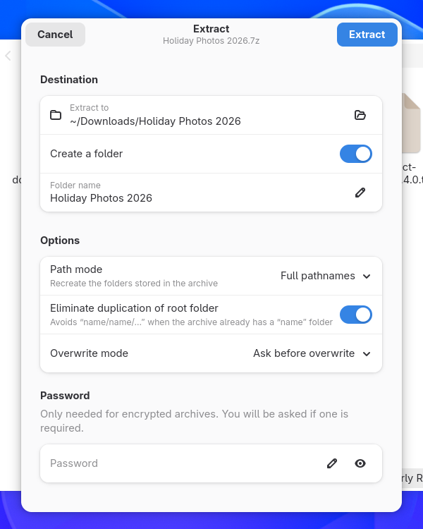
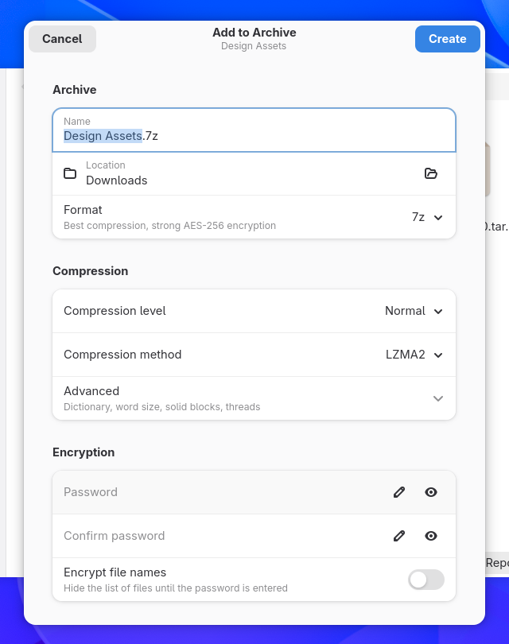
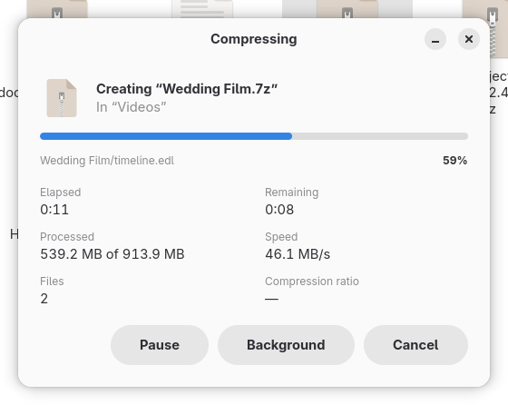
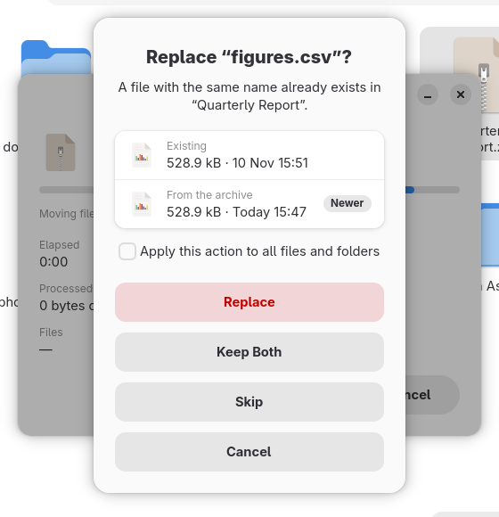
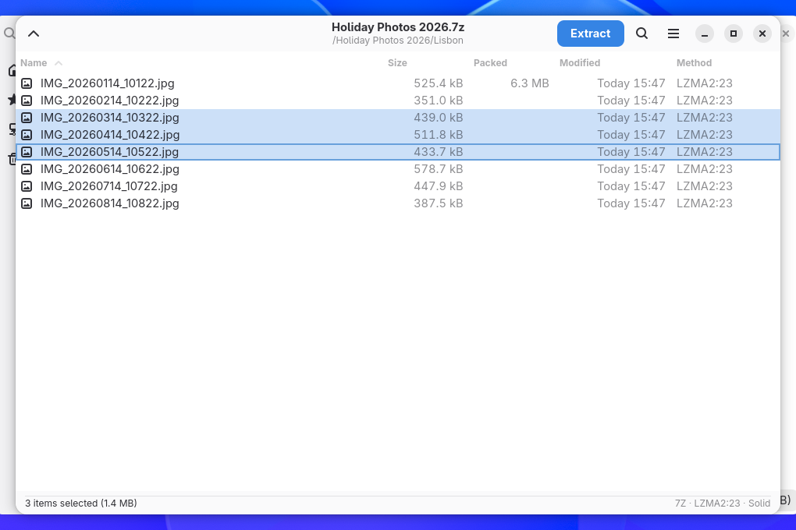
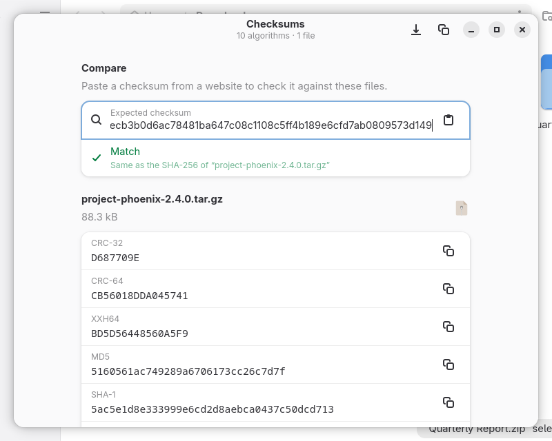
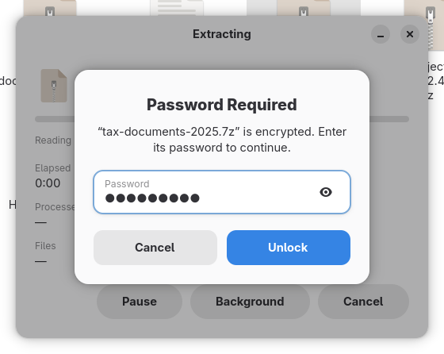
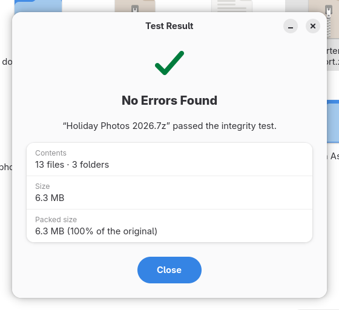
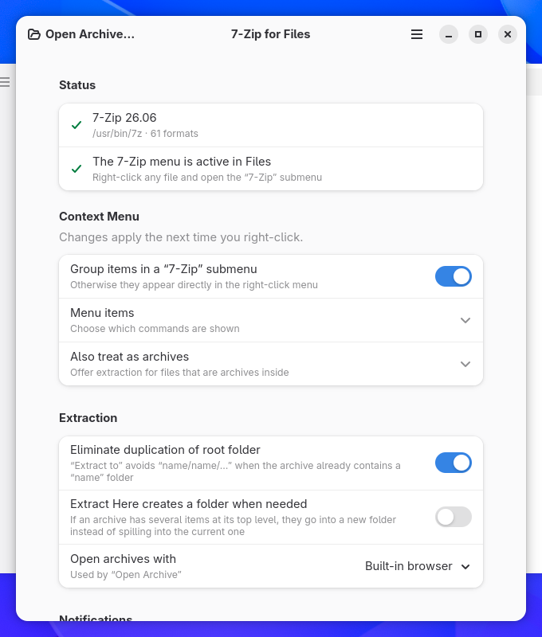

<div align="center">


# 7-Zip for GNOME Files

**The full 7-Zip right-click menu — Open, Extract, Test, Add, Email and CRC SHA — inside GNOME Files (Nautilus).**

ZIP and TAR work out of the box. Install 7-Zip and you also get 7z, RAR, ISO and 40+ more formats.

[](https://github.com/Jire/nautilus-7zip/actions/workflows/ci.yml)
[](LICENSE)

<picture>
  <source media="(prefers-color-scheme: dark)" srcset="docs/screenshots/menu-dark.png">
  
</picture>

</div>

---

## Install

Pick your distribution, paste the line into a terminal, and you're done. Each line installs the
dependencies, installs the extension for your user (no root needed for the extension itself), and
restarts Files so the menu shows up immediately.

### Arch Linux, Manjaro, EndeavourOS, CachyOS

```bash
sudo pacman -S --needed nautilus-python python-gobject libadwaita 7zip curl && curl -fsSL https://raw.githubusercontent.com/Jire/nautilus-7zip/main/install.sh | bash && nautilus -q
```

### Ubuntu, Debian, Zorin OS (any distribution that uses GNOME Files)

```bash
sudo apt install -y python3-nautilus python3-gi gir1.2-gtk-4.0 gir1.2-adw-1 7zip curl && curl -fsSL https://raw.githubusercontent.com/Jire/nautilus-7zip/main/install.sh | bash && nautilus -q
```

Want RAR support too? Debian-based distributions ship RAR as a separate plugin
(Ubuntu: *multiverse*, Debian: *non-free*):

```bash
sudo apt install -y 7zip-rar
```

### Fedora

```bash
sudo dnf install -y nautilus-python python3-gobject libadwaita 7zip curl && curl -fsSL https://raw.githubusercontent.com/Jire/nautilus-7zip/main/install.sh | bash && nautilus -q
```

Then right-click any file in Files and open the **7-Zip** submenu.

> [!TIP]
> Don't want 7-Zip? Leave `7zip` out of the command. ZIP, TAR, `.tar.gz`, `.tar.xz`, `.tar.bz2`
> (and `.tar.zst` with Python 3.14) still work everywhere, using Python's standard library.

<details>
<summary><b>Prefer to read the installer first, or install from a clone?</b></summary>

```bash
git clone https://github.com/Jire/nautilus-7zip.git
cd nautilus-7zip
less install.sh                 # it only copies files into ~/.local
./install.sh                    # add --restart to restart Files for you
```

`./install.sh --help` lists every option. `sudo ./install.sh --system` installs for all users
(into `/usr/local`), and packagers can use `./install.sh --system --prefix /usr --destdir "$pkgdir"`
(there is a ready-made [`PKGBUILD`](packaging/arch/PKGBUILD) for Arch).

</details>

### Requirements

| | Minimum | Notes |
|---|---|---|
| GNOME Files (Nautilus) | 43 | Tested up to 51. |
| nautilus-python | 4.0 | Use 4.1+ with Files 49 or newer. |
| Python | 3.10 | 3.14 adds built-in Zstandard support. |
| GTK 4 / libadwaita | 4.12 / 1.5 | Ubuntu 24.04, Debian 13, Fedora 40 or newer. |
| 7-Zip | optional | `7z`, `7zz`, `7za` or `7zr`, from the `7zip` package. p7zip works too. |

> [!NOTE]
> This is a **Files (Nautilus) extension**, not a GNOME Shell extension: GNOME Shell extensions
> can't change the Files right-click menu, so it can't be installed from extensions.gnome.org.
> Linux Mint (Nemo) and COSMIC Files use different file managers and are not supported.

---

## The menu

Everything 7-Zip puts in the Windows Explorer menu, in the same order, behaving the same way:

| 7-Zip on Windows | In GNOME Files | Without 7-Zip installed |
|---|---|---|
| Open archive | **Open Archive** opens a built-in archive browser (or 7-Zip File Manager / your default app) | ZIP & TAR |
| Extract files… | **Extract Files…** destination, path mode, overwrite mode, password | ZIP & TAR |
| Extract Here | **Extract Here** | ZIP & TAR |
| Extract to "name\\" | **Extract to “name/”**, without a duplicated `name/name/` folder | ZIP & TAR |
| Test archive | **Test Archive** with a result summary | ZIP & TAR |
| Add to archive… | **Add to Archive…** with every 7-Zip option | ZIP & TAR formats |
| Compress and email… | **Compress and Email…** | ✓ |
| Add to "name.7z" | **Add to “name.7z”** | — |
| Compress to "name.7z" and email | **Compress to “name.7z” and Email** | — |
| Add to "name.zip" | **Add to “name.zip”** | ✓ |
| Compress to "name.zip" and email | **Compress to “name.zip” and Email** | ✓ |
| CRC SHA ▸ | **CRC SHA ▸** CRC-32, CRC-64, XXH64, MD5, SHA-1, SHA-256, SHA-384, SHA-512, SHA3-256, BLAKE2sp, all of them, or save a `.sha256` file | CRC-32, MD5, SHA family |
| Test archive (checksum files) | **Verify Checksums** for `.sha256`, `.md5`, `SHA256SUMS`, `.sfv`… | ✓ |

With several archives selected you get **Extract Each to Separate Folder** and **Test Archives**.
Right-click any part of a split archive (`.7z.001`, `.part2.rar`, `.z01`, `.r00`…) and it just works.

## Screenshots

<table>
  <tr>
    <td width="50%"><br><sub><b>Extract Files…</b> — destination, “create a folder”, path mode, overwrite mode, password.</sub></td>
    <td width="50%"><br><sub><b>Add to Archive…</b> — format, level, method, dictionary, word size, solid blocks, threads, memory estimate, encryption, volumes, update and path modes, SFX…</sub></td>
  </tr>
  <tr>
    <td><br><sub>A progress window modelled on 7-Zip’s: elapsed, remaining, speed, files — with <b>Pause</b>, <b>Background</b> and <b>Cancel</b>.</sub></td>
    <td><br><sub>Name conflicts: <b>Replace</b>, <b>Keep Both</b>, <b>Skip</b>, optionally for all files, with sizes, dates and a “Newer” hint.</sub></td>
  </tr>
  <tr>
    <td><br><sub><b>Open Archive</b> — browse folders, search the whole archive, sort, open files, extract a selection.</sub></td>
    <td><br><sub><b>CRC SHA</b> — every algorithm 7-Zip has; paste a checksum from a website to compare.</sub></td>
  </tr>
  <tr>
    <td><br><sub>Passwords are asked for only when needed and checked before a long extraction starts.</sub></td>
    <td><br><sub><b>Test Archive</b> — integrity check with a summary.</sub></td>
  </tr>
</table>

## Details that matter

- **Nothing half-extracted, ever.** Archives are extracted into a hidden staging folder next to the
  destination and moved into place at the end. Cancel, a wrong password or a full disk leaves your
  folder exactly as it was. Moving is instant because it stays on the same disk.
- **Safe by default.** Paths with `..`, absolute paths and symbolic links that point outside the
  destination (“zip slip”) are refused. Passwords go to 7-Zip on its standard input and never appear
  on a command line, where other users could read them.
- **`.tar.gz` in one step.** 7-Zip on Windows extracts `x.tar.gz` to `x.tar` and stops; here you get
  the files. Permissions and symbolic links are kept.
- **Smart naming.** “Extract to” uses `photos/` for `photos.tar.gz`, `photos.7z.001` and
  `photos.part1.rar` alike, and skips the duplicated folder when the archive already contains `photos/`.
  “Add to” never offers to add an archive to itself.
- **Multi-volume aware.** Selecting several parts of a split archive extracts it once.
- **It tells you what's wrong.** Wrong password (with *Try Again*), missing volume, truncated download,
  damaged data, unsupported method, no space left — in plain words, with the raw 7-Zip output one click
  away. If something needs 7-Zip, you get the exact install command for your distribution.
- **Background work.** *Background* lowers the job's priority and hides the window; you get a
  notification with a *Show in Files* button when it finishes.
- **Email that actually attaches.** With Thunderbird, Evolution, Geary, KMail and friends the archive is
  attached to a new message. If your email opens in a web browser (webmail can't receive attachments
  from other apps), the archive is saved next to the originals and one click shows it in Files, ready
  to drag into your message.
- **Documents and packages count too.** `.docx`, `.odt`, `.epub`, `.jar`, `.apk`, `.deb`, `.rpm`,
  `.iso`, `.exe`, `.msi`, disk images… are archives inside, just like 7-Zip treats them. You can turn
  each group off in the preferences.
- **Fits GNOME.** GTK 4 and libadwaita, light and dark style, keyboard friendly (Esc closes dialogs,
  Enter confirms), windows open in front, translatable.

## Preferences

Open **7-Zip for Files** from the app grid (or run `nautilus-7zip preferences`) to:

- show the items in a **7-Zip submenu** or directly in the menu, and choose which items appear,
- choose whether disk images, packages and documents count as archives,
- toggle *Eliminate duplication of root folder* and a “smart” *Extract Here* that creates a folder
  when an archive has several items at its top level,
- pick what *Open Archive* uses: the built-in browser, 7-Zip File Manager (`7zFM`) or your default app,
- see which 7-Zip build is used (and whether RAR support is present), or point it at another one.

<p align="center"></p>

The archive browser is also registered for archives, so it appears in **Open With…** in Files.

## Command line

The helper behind the menu can be used directly:

```bash
nautilus-7zip extract --here -- archive.7z         # or --to-folder, --dialog, --dest DIR
nautilus-7zip test -- *.zip
nautilus-7zip add --format zip -- photos/          # or --dialog, --email; any format from the dialog
nautilus-7zip hash --algorithm all -- disk.iso     # or --algorithm sha256 --save
nautilus-7zip verify -- SHA256SUMS
nautilus-7zip open archive.rar
```

## Uninstall

```bash
~/.local/share/nautilus-7zip/uninstall.sh && nautilus -q
```

(For a system-wide install: `sudo /usr/local/share/nautilus-7zip/uninstall.sh`.) Your settings stay in
`~/.config/nautilus-7zip` in case you come back; delete that folder to remove them too.

## Troubleshooting

<details>
<summary><b>There is no 7-Zip item in the right-click menu</b></summary>

1. Restart Files once after installing: `nautilus -q`, then open Files again.
2. Check that nautilus-python is installed: `pacman -Q nautilus-python`, `apt policy python3-nautilus` or
   `rpm -q nautilus-python`.
3. Open **7-Zip for Files** from the app grid: the *Status* section says what is missing.
4. Still nothing? Run Files with logging and look for lines starting with `nautilus-7zip:`:
   ```bash
   nautilus -q; NAUTILUS_7ZIP_DEBUG=1 nautilus
   ```
</details>

<details>
<summary><b>Fedora 43: extensions stopped working after upgrading to GNOME 49</b></summary>

GNOME 49 needs nautilus-python 4.1 or newer: `sudo dnf upgrade --refresh nautilus-python && nautilus -q`.
</details>

<details>
<summary><b>RAR archives say “RAR support is not installed”</b></summary>

Debian and Ubuntu build 7-Zip without the RAR decoder. Install the plugin with
`sudo apt install 7zip-rar` (enable *multiverse* on Ubuntu or *non-free* on Debian first).
</details>

<details>
<summary><b>“Add to “name.7z”” is missing</b></summary>

Creating `.7z` archives needs 7-Zip. Install the `7zip` package; the item appears on your next right-click.
</details>

## Development

```bash
git clone https://github.com/Jire/nautilus-7zip.git && cd nautilus-7zip
python3 -m pytest                                      # engines, menu, 7-Zip output parsing, installer
mkdir -p ~/.local/share/nautilus-python/extensions
ln -sf "$PWD/extension/nautilus-7zip.py" ~/.local/share/nautilus-python/extensions/
nautilus -q                                            # the extension finds ../src by itself
PYTHONPATH=src python3 -m nautilus7zip preferences     # run the helper from the checkout
```

Useful environment variables: `NAUTILUS_7ZIP_DEBUG=1` (log what runs), `NAUTILUS_7ZIP_DISABLE=1`
(pretend 7-Zip isn't installed, to try the built-in engines) and `NAUTILUS_7ZIP_BINARY=/path/to/7zz`.

How it fits together: [`extension/nautilus-7zip.py`](extension/nautilus-7zip.py) runs inside Files and
only builds the menu ([`menu.py`](src/nautilus7zip/menu.py)). Every action starts the helper application
([`app.py`](src/nautilus7zip/app.py)) in its own process, so a huge or broken archive can never freeze
or crash Files. The helper drives the `7z` program ([`engines/sevenzip.py`](src/nautilus7zip/engines/sevenzip.py))
or the pure-Python engines ([`engines/builtin.py`](src/nautilus7zip/engines/builtin.py),
[`engines/writers.py`](src/nautilus7zip/engines/writers.py)).

Translations are welcome: generate the template with
`xgettext --from-code=UTF-8 -L Python -o po/nautilus-7zip.pot $(find src extension -name '*.py')`,
then add `po/<language>.po`; the installer compiles it.

## License

[MIT](LICENSE). Not affiliated with or endorsed by Igor Pavlov or the 7-Zip project. 7-Zip is free
software by Igor Pavlov ([7-zip.org](https://www.7-zip.org)), used here as an external program when
it is installed.
